# OperaSimVR（Unity + PhysX）

ROSと連携して、建設機械や地形を表示・操作するシミュレータです。

## コーンを置いてみる

**この手順では、地面に2点を置き、その間にコーンを並べて保存します。**

ウィンドウの表示は英語です。説明は日本語で、太字の英語は画面に表示される名前と同じです。上から1ステップずつ進めてください。

**Unity Editorの「Scene」タブを使います。上部の ▶（Play）は押さず、停止したまま作業します。**

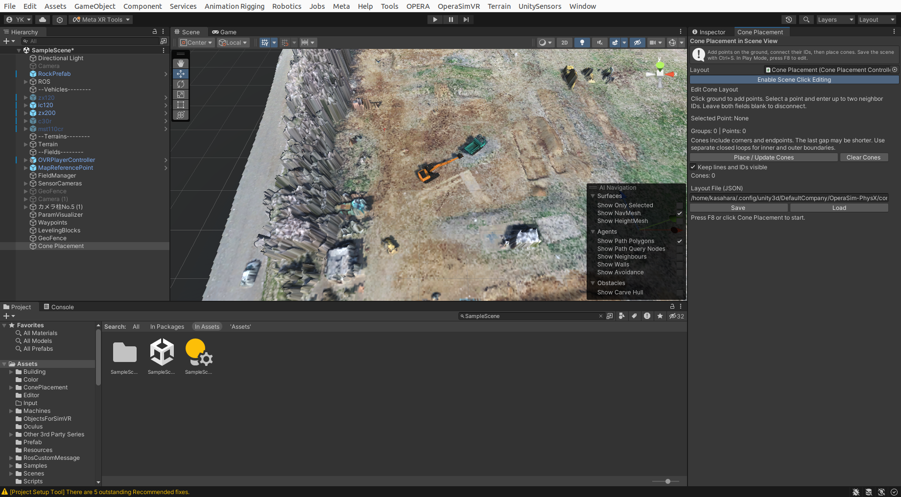

### 1. Unity Editorを開く

`OperaSimVR` フォルダでターミナルを開き、次のコマンドを実行します。

```bash
./operasimvr-unity-ubuntu --open-only
```

Unity Editorが開いたら、次へ進みます。初回は読み込みに時間がかかります。

### 2. SampleSceneを開く

下の **Project** で `Assets → Scenes → SampleScene` をダブルクリックします。すでにHierarchyに **SampleScene** が表示されていれば、そのまま次へ進めます。

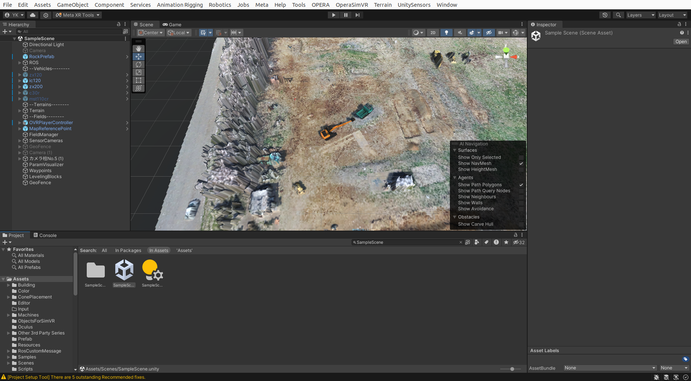

### 3. コーンのウィンドウを開く

上部メニューで **OperaSimVR → Cone Placement → Edit Layout** を選びます。

別枠のウィンドウで開く場合もあります。画像では右端に置いています。

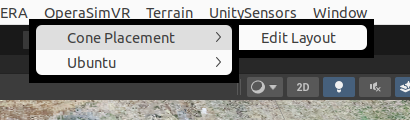

### 4. コーン配置機能を追加する

**Add Cone Placement to Scene** を押します。このボタンがなく、**Layout** にオブジェクトが入っていれば追加済みです。

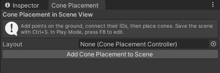

ここからは、まだ点がない状態を例にします。すでに点がある場合は、その点の番号を使って読み替えてください。既存の配置は消さずに続けられます。

### 5. 地面をクリックできる状態にする

**Enable Scene Click Editing** を押して、オンにします。

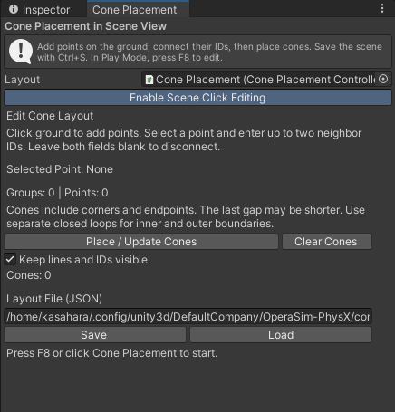

### 6. 1つ目の点を作る

中央の **Scene** で、コーンを並べたい地面を1回クリックします。**P1** が現れます。


### 7. 2つ目の点を作る

同じ地面の、少し離れた場所を1回クリックします。**P2** が現れます。

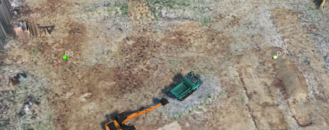

### 8. P1を選ぶ

**P1のそばにある丸いハンドル** をクリックします。ウィンドウに **Selected Point: P1** と表示されれば選択できています。

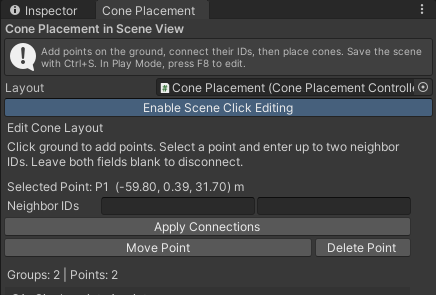

### 9. 接続先に「2」を入れる

**Neighbor IDs** の左の欄に `2` を入力します。右の欄は空欄のままにします。

`P2` ではなく、数字の `2` だけを入力してください。

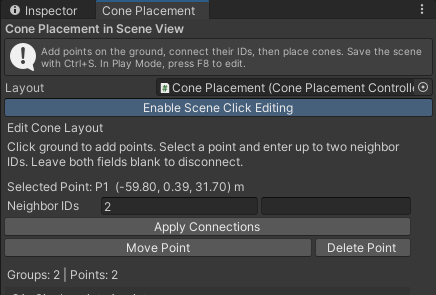

### 10. 2点をつなぐ

**Apply Connections** を押します。P1とP2の間に緑色の線が現れます。

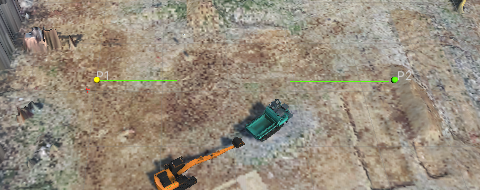

### 11. コーンの間隔を決める

**Spacing (m)** に `2` を入力します。約2m間隔で並べる設定です。

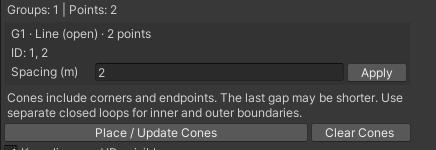

### 12. コーンを並べる

**Place / Update Cones** を押します。緑色の線に沿ってコーンが並びます。**Cones:** の右に配置数が表示されます。

小さい **Apply** ボタンを押す必要はありません。端点にも置くため、最後の間隔は2mより短くなる場合があります。

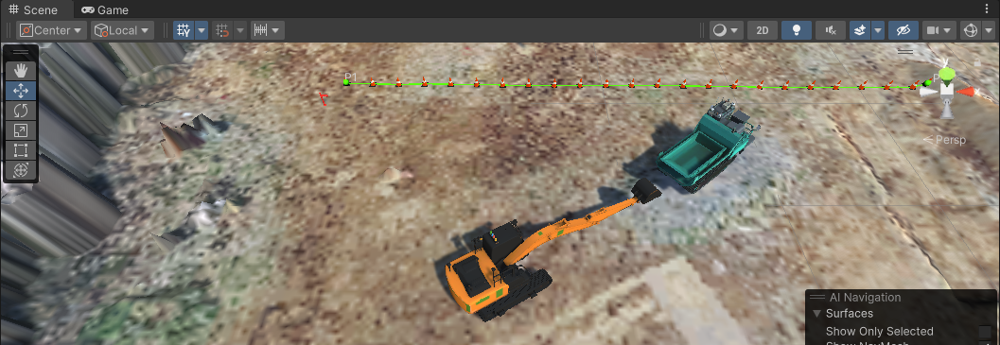

### 13. 保存する

**Ctrl+S** でシーンを保存します。点・接続・間隔も一緒に保存されます。

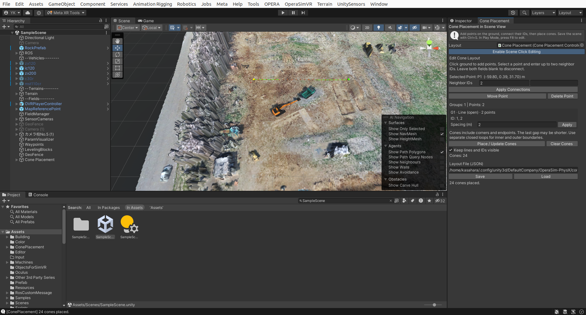

次に開いたときは **Edit Layout** を開くと、保存した配置が再表示されます。

## 配置したコーンをROS 2へ送る

**Playボタンは不要です。** 最初に受信側を起動します。

```bash
./operasimvr-cone-service
```

`Cone service ready` と表示されたら、コーンのウィンドウで順に操作します。

1. **Connection Settings** を開く。同じPCなら **Host: `127.0.0.1` / Port: `10001`** のままで使えます。
2. **Place / Update Cones** を押す。
3. **Send Layout to ROS 2** を1回押す。
4. **Accepted: Layout replaced.** が表示されたら受信完了です。

最大20グループです。G番号の小さい順に先頭から詰め、残りの枠は空で送ります。**応答を1回受信したら終了し、自動再送しません。** 拒否の応答でも終了し、理由を表示します。

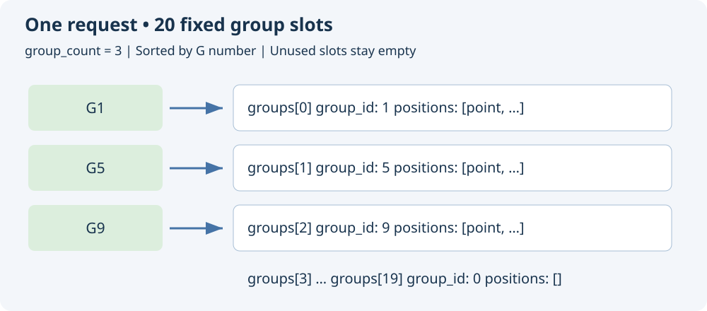

[接続設定・サービス型・受信側サンプル・座標系の詳しい説明](docs/CONE_ROS2_SERVICE.md)

## 操作に迷ったら

| 困ったこと | 操作 |
| --- | --- |
| 地面が見づらい | Scene上でホイールで拡大・縮小。Alt＋左ドラッグで視点を回転、ホイールボタンのドラッグで移動。 |
| 地面を押しても点ができない | **Scene** タブを選び、**Enable Scene Click Editing** がオンか確認。Terrain以外の地面にはColliderと **ConePlacementSurface** が必要。 |
| ボタンが見えない | コーンのウィンドウ内を下にスクロールするか、ウィンドウを縦に広げる。 |
| 違う場所に点を置いた | **Ctrl+Z** で1つ戻す。 |
| 点を移動したい | 点の丸いハンドルを選択 → **Move Point** → 移動先の地面をクリック。 |
| 間隔を変えたい | **Spacing (m)** を変更 → **Place / Update Cones** → **Ctrl+S**。 |
| 通常のシーン編集に戻りたい | **Enable Scene Click Editing** をオフにする。 |

## 次に試すこと

- [四角い囲い・二重の囲い・JSON保存・Playerでの操作](docs/CONE_PLACEMENT.md)
- [Ubuntuの起動・ビルド・ROS連携・VRの設定](docs/UNITY_UBUNTU.md)
- [既存機能の説明：Chapter 1](OperaSimVR_CHAPTER1.md) / [Chapter 2](OperaSimVR_CHAPTER2.md)

**GameビューやPlayerのF8で編集する場合は、終了前に「Layout File (JSON) → Save」で保存してください。** Play中の編集は、Ctrl+Sでは保持できません。

## Explanation
- This system serves as the cyber component of ros2-tms for construction(https://github.com/irvs/ros2_tms_for_construction), a cyber-physical system (CPS) designed for earthwork construction sites.
- This system is an enhanced version of OperaSim-PhysX(https://github.com/pwri-opera/OperaSim-PhysX), the official simulator of the autonomous construction technology development platform OPERA (Open Platform for Earth work with Robotics and Autonomy).
- This system has "nomal mode" and "play mode", "control mode", "prev mode". "Normal mode" is a simulator similar to OperaSim. In "Play mode," the system receives topics such as position, orientation, and joint angles from the actual machine, allowing its movements to be visualized within the server environment. In "Control mode," the system can remotely operate the actual machine by sending command topics. In "Preview mode," the system allows for remote operation of the actual machine while simultaneously performing motion simulation using the simulator's functionalities.
