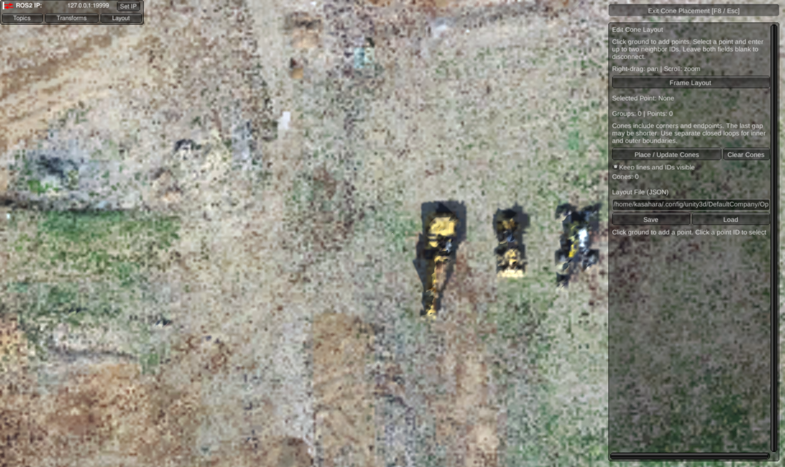

# コーン自動配置

Unity 2022.3.4f1用。**初めて使う場合は、[画像付きの13ステップ](../README.md#コーンを置いてみる)から進めてください。** この文書は、囲いの作り方やPlayerでの操作を説明します。

ウィンドウのメニュー・ボタン・メッセージは英語です。既存の `SampleScene` では実行時に機能が追加されます。

## Gameビュー / Linux Player

1. `SampleScene` をPlayするか、ビルドしたPlayerを起動します。
2. **F8** または右上の **Cone Placement [F8]** を押すと俯瞰編集画面になります。右ドラッグで移動、ホイールで拡大・縮小できます。
3. 地面をクリックして頂点を追加します。各頂点には `P1`, `P2`, … のIDが自動発行されます。IDは削除しても再利用しません。
4. 頂点のID表示をクリックして選び、右側の **Neighbor IDs** に数字だけを0～2個入力し、**Apply Connections** を押します。空欄は未接続です。接続は双方向になり、蛍光色の線が地面に沿って表示されます。自分自身・存在しないID・重複ID・どちらかの頂点の接続数が3以上になる指定は、変更全体を拒否します。
5. 接続関係からグループと間隔フォームが自動生成されます。閉路は **Area (closed)**、端点を持つものは **Line (open)**、未接続の頂点は **Single point** です。エリアと線を同じフィールドに混在できます。
6. グループごとの **Spacing (m)** を入力し、**Place / Update Cones** を押します。フォームの **Apply** を個別に押していなくても、このボタンで現在の入力値を反映します。
7. **F8** または **Esc** で元のカメラに戻ります。



二重の囲いを作る場合は、内周と外周をそれぞれ独立した閉路として定義してください。例: `1–2–3–4–1` と `5–6–7–8–5`。それぞれ別のグループになり、異なる間隔を設定できます。線は `9–10–11` のように端点を接続せずに定義します。二周目のオフセット・列間距離は自動生成しません。

角と端点には必ずコーンを置き、各辺を指定間隔で進みます。最後の余りは指定間隔以下になります。例: 10mの辺に3m間隔なら `0, 3, 6, 9, 10m` に配置します。閉路の始終点や共有する頂点に重複して置きません。孤立点には1個置きます。エリア内部を埋める機能ではなく、境界線上に配置する機能です。

## 変更と保存

選択した頂点は **Move Point** または **Delete Point** で変更できます。接続が変わるとグループを再計算します。同じメンバーのグループの間隔は維持し、分割時は元の間隔を継承します。結合時は共通頂点数が多いグループの間隔を継承し、同数なら最小ID側を優先します。

配置後に頂点・接続・間隔を変更すると古いコーンを非表示にして **changed; update required** と表示します。**Place / Update Cones** で反映してください。地形が変化したときも再配置すると地面高さを取り直します。**Clear Cones** はコーンだけを取り除き、頂点と接続は保持します。

JSON欄のパスと **Save / Load** で座標・ID・接続・グループ間隔を保存・復元できます。既定のパスはUnityの `Application.persistentDataPath/cone-layout-<シーン名>.json` です。保存は一時ファイルを経由して置換します。読込では形式とグラフの整合性を検証し、不正なファイルの場合は現在の配置データを保持します。読込後は配置ボタンでコーンを生成してください。

[二重の囲い＋折れ線のサンプルJSON](examples/cone-layout-double-boundary.json) を用意しています。JSON欄にこのファイルの絶対パスを入れて **Load** → **Place / Update Cones** → **Frame Layout** で確認できます。SampleSceneのZX200初期位置付近の例です。高さは配置時に現在の地面から取り直します。

**Play中の変更は停止すると戻るため、必要なデータは停止前にJSON保存してください。**

## Sceneビューで編集・シーンに保存

1. **OperaSimVR → Cone Placement → Edit Layout** を開きます。
2. **Add Cone Placement to Scene** を押します。すでにある場合は、その配置データが表示されます。
3. **Enable Scene Click Editing** を有効にして、Sceneビューの地面をクリックします。Altによる既存のSceneカメラ操作はそのまま使えます。
4. 頂点のマーカーを選び、同じフォームで接続・間隔・配置を編集します。Undo / Redoに対応します。
5. シーンを保存すると配置データも保存されます。コーンと蛍光線はデータから再生成されます。

Terrainはそのまま地面として使用できます。Planeやメッシュの地面はColliderと **ConePlacementSurface** を追加してください。Inspectorの **Ground Layers** で対象を絞れます。重機などの通常のCollider上には頂点を作りません。

上限は頂点1,000個、コーン10,000個、間隔0.1～10,000mです。過剰な配置要求は生成前に拒否します。生成コーンは表示用の共有メッシュで、重機との物理衝突は追加しません。交差する線や自己交差する閉路の形状判定、規則に対する適合判定は行いません。実際に必要な境界と列間距離を入力してください。

入力方式は `Project Settings → Player → Active Input Handling = Both` に設定しています。導入済みのOpenVRが新Input Systemに依存しているためで、既存の `UnityEngine.Input` による操作も有効です。

## 検証

`Assets/ConePlacement/Tests/Editor` にグラフ・配置計算・JSON・地面選択・斜面への接地・配置更新のNUnitテストがあります。

```bash
./operasimvr-unity-ubuntu --open-only -- \
  -batchmode -nographics -runTests -testPlatform EditMode \
  -testFilter OperaSimVR.ConePlacement.Tests \
  -testResults Logs/cone-placement-tests.xml \
  -logFile Logs/cone-placement-tests.log
```

このPCのBox64環境でTestRunnerのテスト探索が進まない場合は、同じNUnitアサーションをUnity内で直接実行できます。

```bash
./operasimvr-unity-ubuntu --open-only -- \
  -batchmode -nographics \
  -executeMethod OperaSimVR.ConePlacement.Tests.ConeTestBatch.Run \
  -logFile Logs/cone-placement-assertions.log
```

表示確認はビルドしたLinux PlayerでF8を押し、上記のサンプルJSONを読み込んで実行できます。実機への接続を使わずに確認する起動例です。

```bash
OPERASIMVR_MODE=viewer OPERASIMVR_ROS_IP=127.0.0.1 OPERASIMVR_ROS_PORT=19999 \
  ./operasimvr-player-ubuntu --software-rendering
```

## 動作確認結果（2026-11-20）

このPCのUbuntu ARM64 / Box64環境、Unity 2022.3.4f1、Mesa llvmpipeで確認しました。

- Unity内でNUnitアサーションを直接実行し、34件成功・0件失敗。接続数の制限、グループ分割・結合、配置間隔、JSON、不正入力、斜面への接地、編集カメラの復元を検証しました。
- Linux版Playerのビルドが成功しました。
- PlayerでF8による編集開始、地面クリックによる頂点作成、隣接IDによる接続、蛍光線、自動グループ化、頂点削除を確認しました。
- サンプルJSONをPlayerで読み込み、11頂点・3グループを配置しました。フォームから内周だけの間隔を変更し、個別の **Apply** を押さずに **Place / Update Cones** で反映できました。

| 操作 | 内周の間隔 | 配置数 |
| --- | --- | --- |
| サンプルを読込・配置 | 2m | 87個 |
| 内周を変更して再配置 | 4m | 69個 |
| JSON保存・再読込・再配置 | 4m | 69個 |
| 内周を元に戻して再配置・保存 | 2m | 87個 |

外周の3m間隔と折れ線の1.5m間隔は維持され、保存したJSONの頂点・接続も一致しました。検証ログと詳細結果は `Logs/cone-placement-player-resume.log`、`Logs/cone-placement-demo/verification.json` にあります。


初回のPlayer検証では、既存の `UnitySensors.Sensor.LiDAR.LiDARSensor.Init` の `NullReferenceException` が出ていました。今回、`SampleScene` と `SimpleScene` のTerrainから、原因となったScanPattern未設定・参照なしのLiDARコンポーネントを除去しました。LiDARを使用する場合はセンサーを追加し、実際のScanPatternを設定してからPlayしてください。

### 修復後の再検証（2026-11-20）

C#とREADMEの競合記号を除去し、Ubuntuの起動・ビルド処理と補助クラスを復元しました。ARM64環境のビルド用メタデータ生成もネイティブ.NETへ切り替え、通常の `./operasimvr-unity-ubuntu --build` が終了コード0で完了しました。

- Unity内のNUnitアサーションは34件成功・0件失敗でした。
- 新しいPlayerで、初期配置87個 → 内周4mで69個 → 内周2mで87個 → 保存済みの4m設定を読込して69個 → 2mに戻して87個、の操作を確認しました。11頂点・接続・外周と折れ線の間隔は保持されました。
- ローカルTCPのテストで、ZX200の位置2mの変化と4関節の追従、Playerの終了コード0を確認しました。LiDAR例外を許容するオプションは使用せず、実行時例外は0件でした。
- 既定の `Build/Linux` の実行用アセンブリとメインシーンが、操作検証したPlayerの生成物とSHA256で一致しています。

証拠は `Logs/cone-placement-fix/` の `unity-assertions.log`、`assertions.json`、`linux-build-final.log`、`ros-smoke/result.json`、`player-ui.log`、`ui-result.json` に保存しています。

## 英語UIと画像付き手順の確認（2026-11-21）

EditorとPlayerのメニュー・ボタン・入力欄・状態表示・検証エラーを英語に統一しました。[README](../README.md) は、停止中のSceneビューで2点をつないで保存する13ステップに整理しています。

- 既存のUnity内NUnitアサーションは34件成功・0件失敗でした。
- Editorで2頂点・1グループ・2m間隔の24本を配置し、シーン保存・再読込後も24本を復元できました。
- 英語UIを含むLinux版の最終ビルドが終了コード0で完了しました。
- READMEとこの文書の実画面14枚、画像ファイル、ローカルリンクを確認しました。説明用の配置状態は撮影用補助スクリプトでも作成しています。

確認記録は `Logs/cone-english-guide/verification.json`、`assertions.json`、`saved-state.json`、`reloaded-state.json` にあります。撮影用スクリプトは削除し、検証に使ったSampleSceneは元の内容に戻しています。

## ROS 2連携用のグループ別座標取得API

`ConePlacementController.TryGetPlacedGroups(out groups, out error)` で、最後に正常に配置したコーンの座標をグループごとに取得できます。`ConePositionGroup` は `Id`（UIのG番号）、`Key`（構成する頂点ID）、`IsClosed`、`Spacing`、`Positions` を持ちます。

`Positions` はクリックした頂点ではなく、間隔に沿って生成し、地面へ投影した各コーン底面の **Unityワールド座標（m）** です。ROS座標系への変換はこのAPIでは行いません。グループが同じ位置のコーンを共有する場合、その位置は両方のグループに含まれます。表示上のコーンは従来どおり重複生成しません。

未配置、空配置、配置変更後、配置処理の失敗後、生成コーンを手動で移動・非表示・削除した状態では取得に失敗します。`Place / Update Cones` で再配置してください。取得済みのデータは、その後の編集によって書き換わらないスナップショットです。

このAPIを使うROS 2サービス送信を実装しています。**Send Layout to ROS 2** で、固定20枠へG番号順に詰め、未使用の枠を空で送ります。対応する応答を1回受信したら終了します。新しいサービス型、受信サンプル、起動手順は [ROS 2サービス送信ガイド](CONE_ROS2_SERVICE.md) を参照してください。

2026-11-21に、共有コーンのグループ所属、斜面への接地座標、編集後の無効化、手動移動や地面消失後の拒否を含む38件のUnity内アサーションが成功しました。起動中のEditorを維持するため、`Logs/cone-ros-service/unity-tests` の独立した検証用プロジェクトで実行しています。
