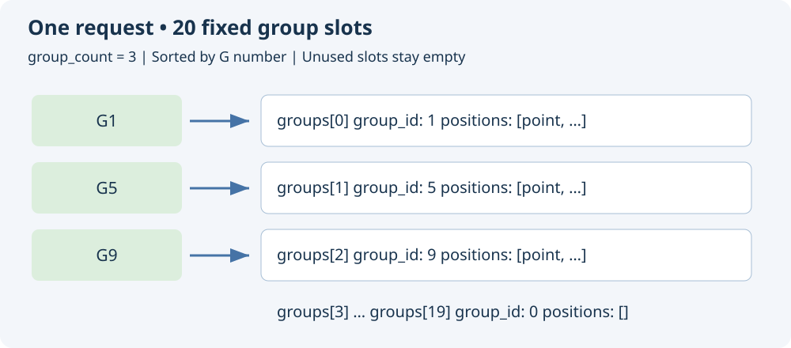

# コーンの配置をROS 2へ送る

配置した全コーンの座標を、**最大20グループの固定枠**でまとめてサービス送信できます。**UnityのPlayボタンは不要です。** ウィンドウの表示は英語です。

## 1. 受信側を起動する

このPCでは、OperaSimVRのフォルダでターミナルを開き、次の1行を実行します。

```bash
./operasimvr-cone-service
```

初回はサービス型と受信サンプルをビルドします。`Cone service ready; accepting one-shot Unity sends.` と `Starting server on 127.0.0.1:10001` が出たら準備完了です。ターミナルは開いたままにします。終了は **Ctrl+C** です。

ROS 2 Humble、colcon、およびROS2版ROS-TCP-Endpoint v0.7が必要です。起動スクリプトは既定で `$HOME/ros2_ws/src/ROS-TCP-Endpoint` のソースを使い、成果物を `Build/ROS2Cones` に作ります。既存のROSワークスペースには書き込みません。別の場所にある場合は次のように指定します。

```bash
OPERASIMVR_ENDPOINT_SRC=/path/to/ROS-TCP-Endpoint ./operasimvr-cone-service
```

## 2. Unityの接続先を確認する

**OperaSimVR → Cone Placement → Edit Layout** を開き、下へスクロールします。**Connection Settings** を開き、同じPCなら次の値を使います。

| 欄 | 入力値 |
| --- | --- |
| Host (dedicated cone endpoint) | `127.0.0.1` |
| Port | `10001` |
| Service | `/cone_placement/set_layout` |
| Frame ID | `unity_world_flu` |

コーン専用の接続です。既存の重機用ROS接続が使う10000番とは分けています。ROS-TCP-Endpointは応答先のキューを接続間で共有するため、このポートにはコーン送信以外のクライアントを接続しないでください。

## 3. コーンを配置する

**Place / Update Cones** を押します。送るのは、クリックした頂点ではなく、**間隔に沿って並べ、地面の高さに合わせたコーン底面の座標**です。

配置後に点・接続・間隔を変えた場合は、もう一度このボタンを押してください。未配置、空配置、変更後、配置失敗後、生成コーンを手動で移動・削除・非表示にした状態では送信を止めます。21グループ以上の場合も、切り捨てずにエラーを表示します。

## 4. 送信する

**Send Layout to ROS 2** を1回押します。

要求は1回だけ送ります。対応する応答を1回受信したら、接続を閉じて終了します。応答が成功でも拒否でも終了し、自動再送しません。以前の送信から遅れて届いた応答は、識別番号で区別して読み飛ばします。

| 表示 | 意味 |
| --- | --- |
| `Sending once; waiting for one response...` | 送信中。二重送信はできません。 |
| `Accepted: Layout replaced.` | 受信側が配置を受け付けました。送信は終了しています。 |
| `Rejected: ...` | 拒否理由が表示されます。応答は届いており、送信は終了しています。 |
| `No response confirmed: ...` | 接続エラー、切断、またはタイムアウトです。自動再送しません。 |

既定では接続開始から15秒で待機を終了します。**応答を確認できなかった場合も、ROS 2側では適用済みの可能性があります。** ターミナルの受信表示を確認してください。**Stop Waiting**、ウィンドウの閉鎖、スクリプト再読込、シーンの終了でも待機を止めます。受信側で開始済みの処理を取り消す機能ではありません。

正常受信時のターミナル表示例です。

```text
Accepted frame=unity_world_flu: groups[0]=G1 (6 cones), groups[1]=G3 (1 cones)
```

応答後にEndpointが `Exception: No more data available` と表示する場合があります。導入済みEndpointが、送信終了時のTCP切断をこの文言で記録します。Unityに `Accepted` と出ていれば、応答の受信は完了しています。

## 20枠への格納方法



`groups` は長さが必ず20の固定配列です。それぞれの要素に、そのグループ専用の `positions` フィールドがあります。`group_count` は使用中のグループ数です。

G番号が `G1`, `G5`, `G9` なら、`groups[0]`, `groups[1]`, `groups[2]` にこの順で格納します。残りの `groups[3]`～`groups[19]` は `group_id=0`, `positions=[]` で送ります。G番号と配列の添字は別です。

同じ物理コーンを複数グループが共有する場合、座標は各グループに含まれます。応答の `cone_count` は各グループの座標数の合計なので、画面の物理コーン数より多くなる場合があります。

型定義は [ConeGroup.msg](../ros2/operasimvr_interfaces/msg/ConeGroup.msg) と [SetConeLayout.srv](../ros2/operasimvr_interfaces/srv/SetConeLayout.srv) にあります。

```text
# ConeGroup.msg
uint32 group_id
geometry_msgs/Point[] positions
```

```text
# SetConeLayout.srv
string frame_id
uint32 group_count
operasimvr_interfaces/ConeGroup[20] groups
---
bool success
string message
uint32 group_count
uint32 cone_count
```

## 座標系を合わせる

既定の `unity_world_flu` は、Unityのワールド座標をROSの **前がX・左がY・上がZ** に変換した座標系です。単位はmです。

```text
ROS (x, y, z) = Unity (z, -x, y)
Unity (1, 2, 3) → ROS (3, -1, 2)
```

別の原点や向きを使う場合は、Unityで **Cone Placement** オブジェクトを選び、Inspectorの **ROS 2 Service → Frame Origin** に基準のTransformを指定します。基準の位置を引き、基準の回転の逆を適用してから、上記の軸変換を行います。Scaleは使いません。空欄ならUnityのワールド原点・ワールド軸を使います。同じInspectorで **Timeout Seconds** も変更できます。

**Frame IDを `map` に書き換えるだけでは、既存のROSのmap座標にはなりません。** `Frame Origin` を受信側の座標系に合わせてください。このプロジェクトの重機用の日本測地系変換や個別オフセットは自動適用しません。設定を保存する場合は、停止中に **Ctrl+S** を押します。

## 受信サンプルを自分の処理につなぐ

[receiver.py](../ros2/operasimvr_cone_receiver/operasimvr_cone_receiver/receiver.py) の `receive()` が受信処理です。20枠・グループ数・IDの順序・空枠・有限な座標を確認し、受信した配置で `self.layout` 全体を置き換えて応答します。同じ要求が再び来ても追記しません。

受信結果をJSONにも保存する場合は、起動時に保存先を指定します。

```bash
./operasimvr-cone-service output_path:=/tmp/received-cones.json
```

自分の受信ノードに替える場合は、同じサービス名と型で起動し、専用Endpointだけを起動します。

```bash
source /opt/ros/humble/setup.bash
source Build/ROS2Cones/install/local_setup.bash
ros2 run operasimvr_cone_receiver cone_endpoint --ros-args \
  -p ROS_TCP_PORT:=10001 -p ROS_IP:=127.0.0.1 \
  -p service_name:=/cone_placement/set_layout
```

このEndpointは受信サービスを発見してからTCP待受を始めます。標準の `default_server_endpoint` の代わりに、付属の `cone_endpoint` を使ってください。

## 別のPCで受信する場合

受信PCへ `ros2` 以下の2パッケージとROS2版ROS-TCP-Endpointを用意してビルドします。起動スクリプトを使える環境なら、次のように起動できます。

```bash
./operasimvr-cone-service tcp_ip:=0.0.0.0
```

Unityの **Host** には受信PCのIPアドレスを入力します。Portは双方で揃えます。受信ノードとEndpointは同じ `ROS_DOMAIN_ID`・RMWの設定で起動してください。

## 検証

Unity 2022.3.4f1とROS 2 Humbleで、停止中Editor相当のバッチ処理から、実際のEndpoint・rclpy受信サービスまでの往復を検証しています。

- Unity内アサーション49件成功。固定20枠、1・3・20グループ、疎なG番号、21グループの拒否、座標変換、成功／拒否応答後の切断、タイムアウト・中止時の再送なしを確認。
- C#の送信バイト列をネイティブrclpyで読み込み、再シリアライズした結果も一致。
- 実通信でG1・G3の7本を受信し、成功応答後に終了。不正要求の拒否応答でも終了。

記録は `Logs/cone-ros-service/`、検証用の独立Unityプロジェクトはその中の `unity-tests/` です。通常のEditorで開いたシーンや配置を変更せずに確認しています。
